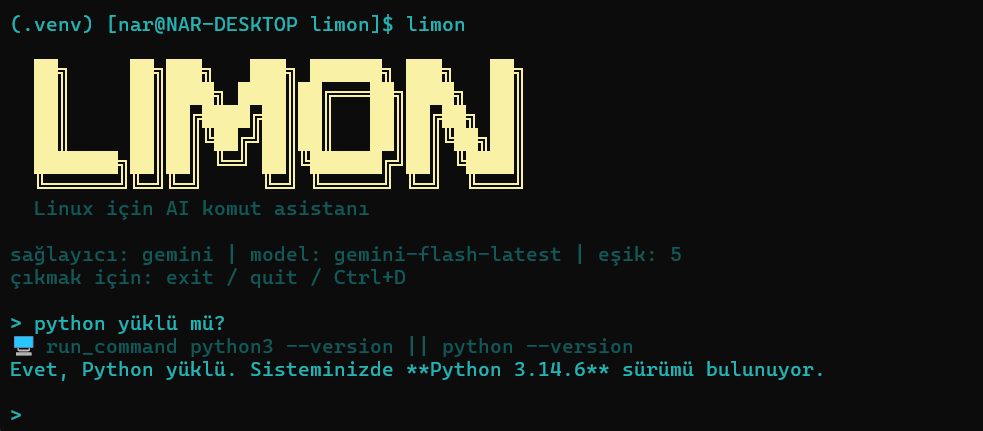

# 🍋 limon

**Terminalde çalışan AI asistanı.** İsteğini normal bir cümleyle yazarsın; limon projeni inceler, dosya okur ve düzenler, komut çalıştırır, sonucu sana anlatır. Riskli bir işlem yapmadan önce onayını ister.

Desteklenen sağlayıcılar: **OpenAI (ChatGPT)** · **Google Gemini** · **Anthropic Claude** · **Ollama (yerel)**




## Neler yapabilir?

- Projeni anlar: "Bu proje ne yapıyor, nereden başlamalıyım?"
- Kod arar ve düzenler: "Bu hatayı bul, sebebini açıkla ve düzelt."
- Test ve komut çalıştırır: "Testleri çalıştır, kırılanları düzelt."
- Dosya oluşturur, siler; değiştirdiği dosyaların yedeğini alır.
- Web sayfası okur, güncel bilgiye bakar.
- Git, build ve paket kurulumu gibi terminal işlerini yapar.

## Kurulum

Python 3.9 veya üstü gerekir. Tek komut yeterli:

**Windows (PowerShell)**

```powershell
irm https://aardaakpinar.github.io/limon/install.ps1 | iex
```

**Linux / macOS**

```bash
curl -fsSL https://aardaakpinar.github.io/limon/install.sh | bash
```

Kurulumdan sonra **yeni bir terminal aç**. `limon` artık her yerden çalışır; sanal ortam etkinleştirmen gerekmez.

- Kurulum `~/.limon` (Windows: `%USERPROFILE%\.limon`) altına yapılır. Bu klasörü silme veya taşıma.
- Aynı komutu tekrar çalıştırmak limon'u günceller. Güncellemek için `limon update` de kullanabilirsin.
- Ayarları silmek için `limon uninstall`; paketi tamamen kaldırmak için `pip uninstall limon`.

<details>
<summary>Yalnızca tek bir sağlayıcı kurmak istersen</summary>

```bash
# Linux / macOS
curl -fsSL https://aardaakpinar.github.io/limon/install.sh | bash -s -- --extras claude
```

```powershell
# Windows
$env:LIMON_EXTRAS = "claude"; irm https://aardaakpinar.github.io/limon/install.ps1 | iex
```

`claude`, `openai`, `gemini` veya `all` yazabilirsin.

</details>

<details>
<summary>Kaynaktan kurulum (geliştiriciler)</summary>

```bash
git clone https://github.com/aardaakpinar/limon.git
cd limon
bash install.sh                                        # Linux / macOS
powershell -ExecutionPolicy Bypass -File .\install.ps1 # Windows
```

</details>

## İlk kullanım

Önce ayarları yap:

```bash
limon config
```

Sihirbaz sırayla sağlayıcıyı, API anahtarını ve modeli sorar. Anahtarın yoksa sağlayıcının web panelinden oluşturabilirsin: [OpenAI](https://platform.openai.com/api-keys), [Gemini](https://aistudio.google.com/apikey), [Anthropic](https://console.anthropic.com/settings/keys).

| Sağlayıcı | Varsayılan model      | API anahtarı        |
| --------- | --------------------- | ------------------- |
| `openai`  | `gpt-4.1`             | `OPENAI_API_KEY`    |
| `gemini`  | `gemini-flash-latest` | `GEMINI_API_KEY`    |
| `claude`  | `claude-sonnet-5-5`   | `ANTHROPIC_API_KEY` |
| `ollama`  | `llama3.1`            | gerekmez            |

Anahtarı sihirbaza yazabilir veya ortam değişkeni olarak tanımlayabilirsin. Ayarlar `~/.config/limon/config.json` dosyasında tutulur (Windows: `%USERPROFILE%\.config\limon\config.json`).

**Ollama kullanacaksan** anahtar gerekmez; `ollama serve` çalışıyor olmalı ve araç destekleyen bir model çekilmiş olmalı:

```bash
ollama pull llama3.1
limon config    # sağlayıcı: ollama
```

## Kullanım

```bash
limon
```

Etkileşimli mod açılır. Doğal dille isteğini yaz:

```text
> Bu projedeki testleri çalıştır ve kırılanları düzelt.
> README'yi daha sade bir hale getir.
> Son commit'te ne değişmiş? Özetle.
```

Tek seferlik soru sormak için:

```bash
limon -p "bu klasördeki dosyaları özetle"
```

Etkileşimli modda `/config` ayarları, `/model` model listesini açar; `/reset` konuşmayı sıfırlar. Çıkmak için `exit` veya `Ctrl+D`.

### Sık kullanılan komutlar

| Komut             | Ne yapar                                      |
| ----------------- | --------------------------------------------- |
| `limon`           | Etkileşimli modu başlatır                     |
| `limon -p "soru"` | Tek seferlik istek çalıştırır                 |
| `limon config`    | Sağlayıcı, model, API anahtarı ve eşik ayarı  |
| `limon models`    | Sağlayıcının güncel model listesini gösterir  |
| `limon update`    | Son sürüme günceller (`--check` ile denetler) |
| `limon uninstall` | Limon ayarlarını siler                        |
| `limon --version` | Sürümü gösterir                               |

## Güvenlik

- limon her işleme **0–10 arası tehlike puanı** verir. Varsayılan eşik **5**'tir; eşiği aşan komutlar için senden onay ister.
- `~/.ssh`, `.env`, `*.pem` gibi hassas dosyaları okumak ve özel ağlara erişmek de onay gerektirir.
- Üzerine yazılan veya silinen dosyalar `.limon_backups/` klasörüne yedeklenir.
- `run_command` doğrudan kabukta çalışır. Tehlike puanı kuralları kusursuz değildir; kritik sistemlerde eşiği düşük tut.
- API anahtarların yalnızca yerel ayar dosyasında durur ve sadece seçtiğin sağlayıcıya gönderilir.

## Proje notları

Çalıştığın klasöre veya bir üst klasöre `LIMON.md` koyarsan içeriği her oturumda modele proje notu olarak verilir:

```markdown
Testleri `pytest -q` ile çalıştır. Commit mesajlarını Türkçe yaz. `legacy/` klasörüne dokunma.
```

## Arka plan ajanı (isteğe bağlı, Linux)

limon, Linux'ta systemd servislerini, logları ve disk doluluğunu izleyip sorunları teşhis edebilir. Varsayılan olarak yalnızca raporlar; hiçbir işlemi onayın olmadan uygulamaz.

```bash
limon daemon install       # kullanıcı servisi olarak kurar (root gerekmez)
limon daemon status
limon events               # olaylar ve teşhisler
limon approvals            # onay bekleyen işlemler
limon diagnose --last 30m  # son 30 dakikayı teşhis et
limon daemon uninstall
```

Bu özellik yalnızca **Linux + systemd** içindir. Windows ve macOS'ta diğer komutlar normal çalışır, daemon komutları açık bir uyarı verir.

## Sorun giderme

**`limon` hiçbir şey yazmadan kapanıyor.** Kurulum klasörü (`~/.limon`) silinmiş veya taşınmış olabilir. Kurulum komutunu yeniden çalıştır; mevcut kurulumu onarır ve günceller:

```powershell
irm https://aardaakpinar.github.io/limon/install.ps1 | iex          # Windows
```

```bash
curl -fsSL https://aardaakpinar.github.io/limon/install.sh | bash    # Linux / macOS
```

**`API anahtarı bulunamadı` veya `401` hatası.** `limon config` ile anahtarı gir ya da ortam değişkenini tanımla (`OPENAI_API_KEY`, `GEMINI_API_KEY`, `ANTHROPIC_API_KEY`). Ollama için anahtar gerekmez; `ollama serve` çalışıyor olmalı.

**Windows'ta çıktıda `?` veya bozuk karakterler.** Windows Terminal kullan veya `chcp 65001` çalıştır. limon bu durumda çökmek yerine gösteremediği karakteri `?` olarak yazar.

**`limon daemon` çalışmıyor.** Arka plan ajanı yalnızca Linux + systemd destekler. Windows/macOS'ta etkileşimli `limon` modu ve diğer komutlar çalışmaya devam eder.

**Model listesi gelmiyor.** `limon models` canlı liste için sağlayıcıya bağlanır; anahtar yoksa, kota dolduysa veya ağ engelliyse liste alınamaz. `limon config` ile model adını elle yazabilirsin.

## Geliştirme

```bash
git clone https://github.com/aardaakpinar/limon.git
cd limon
pip install -e ".[dev]"
pytest
```

- Tehlike kuralları: `limon/danger.py`
- Araçlar: `limon/tools.py`
- Sağlayıcılar: `limon/providers/`

Katkı için bir dal açıp pull request gönderebilirsin. Hata ve öneriler için Issues sekmesini kullan.

## Lisans

[GPL-3.0](LICENSE)
